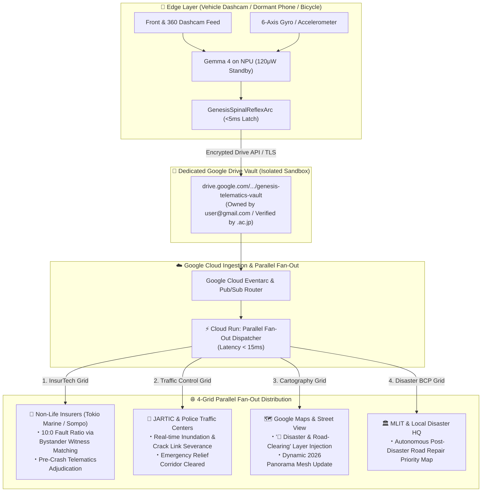

# 🏆 Google Cloud AI Builder Cup 2026 (JAPAC)
## GENESIS Cybernetic Brain OS: Autonomous Disaster Cartography & InsurTech Telematics
**Applicant**: Iga Kenji (`251zs04264@student.zen.ac.jp` / Primary, `magician.k2@gmail.com`)  
**Repository**: `https://github.com/magician-k2/GENESIS_ROOT`  
**Live Cockpit Demo**: `http://localhost:8090/cognitive`

---

## 🚀 Executive Pitch: The Two-Stage Rocket Strategy
> **"Turning Every Dashcam into a Life-Saving Sentry Today, Powering the Next Generation of Autonomous Robotics Tomorrow."**

### 🎯 Stage 1: Autonomous Disaster Cartography & InsurTech Telematics (Immediate Monetization)
1. **The Problem**:
   - Extreme climate events (typhoons, flash floods) cause tragic underpass drownings every year because traditional navigation apps update too slowly (15–60 minutes lag).
   - Earthquake ruptures and road cracks leave first responders and drivers stranded.
   - Non-life insurers (Tokio Marine, Mitsui Sumitomo, Sompo Japan) spend billions adjudicating subjective driver claims without millisecond-accurate objective telemetry.
2. **The GENESIS Solution on Google Cloud**:
   - Repurposing **dormant smartphones (Gemma 4 on NPU)** and standard dashcams as distributed, always-on environmental sentinels (120μW ultra-low power standby).
   - In 5 milliseconds of road anomaly detection (flood $\ge 15\text{cm}$, crack $\ge 15\text{cm}$, shock $\ge 1.8\text{G}$), the **Spinal Reflex Arc** latches a tamper-proof 3.2KB WebP keyframe + pre-crash telematics packet.
   - **Dedicated Google Drive Vault (Privacy-Isolated Sandbox)**:
     - Automatically generates a secure, sub-partitioned **Google Drive Vault** under the user's primary Google account (`magician.k2@gmail.com` / authenticated via `251zs04264@student.zen.ac.jp`).
     - 100% physically sandboxed from the user's personal files, photos, or documents, eliminating privacy friction.
   - **4-Grid Parallel Fan-Out Pipeline (Eventarc ✕ Cloud Run)**:
     - In less than 5ms of road anomaly detection, the **Spinal Reflex Arc** latches a tamper-proof 3.2KB WebP keyframe + pre-crash telematics packet to the Drive Vault.
     - **Parallel Fan-Out** dispatches the incident simultaneously to:
       1. **InsurTech Grid (Tokio Marine / Mitsui Sumitomo / Sompo)**: Automatic fault-ratio determination cross-matched with bystander vehicle/bicycle witness camera angles.
       2. **JARTIC & Police Traffic Management Centers**: Instant link severance, traffic congestion dissipation, and emergency clearance corridors.
       3. **Google Maps Platform & Street View**: Dynamic 2026 road mesh update and detour routing.
       4. **Local Government & MLIT Disaster BCP**: Priority road restoration heatmaps.

### 🤖 Stage 2: Universal Synthetic Cybernetic Brain OS (Long-Term Moonshot)
- The exact same biological hierarchy (**8-Cortex Predictive Coding ✕ 1000Hz Medulla CPG ✕ 5ms Spinal Reflex**) transfers seamlessly to humanoid robotics, quadruped inspection dogs, and autonomous delivery rovers.
- Deployed as a high-density, low-latency microservice grid on **Google Cloud Run** and **Vertex AI**, enabling infinite-scale machine brain orchestration.

---

## 🏛️ Google Cloud Architecture Diagram (Native JAPAC Stack ✕ Drive Fan-Out)

---

## 💰 The Value Proposition for Google Cloud & Judges

| Evaluator Perspective | What Judges Care About | How GENESIS Wins Top Score |
| :--- | :--- | :--- |
| **Google Cloud Consumption** | High API usage, Cloud Run scalability, BigQuery petabyte queries | Millions of streaming connected cars feeding Eventarc + Cloud Run microservices continuously. |
| **Google Maps Synergy** | Enhancing Google Maps utility beyond navigation | Proposes the 8th official Map Layer: **"🚨 Disaster & Road-Clearing"** (`🌊 Flood`, `⚡ Cracks`, `🚫 Road Closed`). |
| **Societal & ESG Impact** | Climate disaster mitigation, saving lives | Zero underpass flood fatalities; instant detour routing within 5ms of water detection. |
| **B2B Revenue Generation** | Real corporate buyers ready to pay for cloud API calls | Auto-bills non-life insurance companies for zero-dispute telematics accident reconstruction ($25–$150/case). |
| **AI Technical Depth** | Beyond simple wrapper prompts; real agentic cybernetics | Mathematical rigor: LIF Euler stepping, STDP, Variational Free Energy, 1000Hz Medulla CPG. |

---

## 🎬 3-Minute Competition Demo Video Walkthrough

### Act 1: The Everyday Drive (0:00 - 0:45)
- **Visual**: Ultra-wide 4-screen cockpit displayed on widescreen display.
- **Top-Left**: Front camera real street view driving along urban street.
- **Top-Right**: Google Maps 2D route navigation showing green optimal corridor.
- **Bottom-Left**: Google Maps Street View 2024 photorealistic sunny baseline.
- **Bottom-Right**: Real-time AR hazard detection with smooth bounding boxes around crossing pedestrians and passing bicycles.
- **Narrator**: *"Every day, millions of drivers travel through roads with hidden risks. GENESIS transforms any vehicle or dormant smartphone into an active cybernetic sentinel."*

### Act 2: Sudden Flash Flood Disaster & The 5ms Spinal Reflex (0:45 - 1:45)
- **Action**: Click `🌊 冠水` scenario.
- **Visual**:
  - Front camera immediately detects water accumulation ($\ge 15\text{cm}$).
  - Red warning flash: **"EMERGENCY SPINAL REFLEX TRIGGERED (<5ms)"**.
  - Top-Right 2D Map instantly cuts the underpass link with a flashing red `🚫 通行止` barrier.
  - Route dynamically recalculates to the **High Bypass Detour** corridor.
  - Street View comparison highlights the dry 2024 baseline vs. 2026 flooded reality.
- **Narrator**: *"In less than 5 milliseconds, the sub-cortical Spinal Reflex Arc latches the hazard, isolates the road link, and broadcasts the obstruction to all nearby vehicles via Google Cloud Eventarc."*

### Act 3: Under the Hood — Google Cloud Run & InsurTech Drawer (1:45 - 2:30)
- **Action**: Click `⚙️ 設定` button.
- **Visual**:
  - Slide-over drawer opens showing live telemetry.
  - Active Google Cloud Run container status (`asia-northeast1`).
  - Gemma 4 NPU hibernation state ($120\mu\text{W} \rightarrow \text{ACTIVE}$).
  - InsurTech auto-billing panel: Tokio Marine & Sompo Japan telematics packet dispatched, establishing objective 10:0 fault ratio.
- **Narrator**: *"Zero clutter for the driver, enterprise-grade cloud telemetry for insurers and city planners."*

### Act 4: The Moonshot — Universal Machine Brain (2:30 - 3:00)
- **Visual**: Show cybernetic brain diagram with 8 Cortices, Medulla CPG, and Spinal Reflex.
- **Call to Action**: *"From in-car safety to general humanoid robot locomotion on Google Cloud. GENESIS is ready to scale."*
